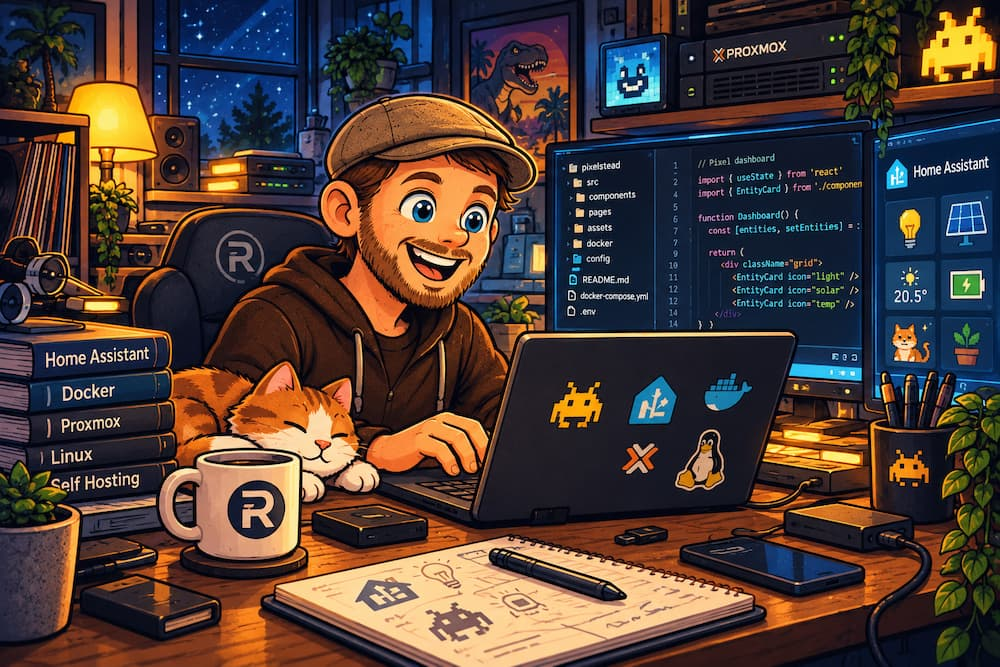

# Hey, I'm Roel! 👋

I like making things work. And occasionally making them look nice, too.

I'm a curious tech enthusiast from the Netherlands, usually tinkering with home automation, self-hosted services, Linux, and whatever idea seems worth trying. Sometimes that turns into a useful tool. Sometimes it's just a fun experiment.

### 🛠️ On my workbench

- **draai** — a little tool I'm preparing to share publicly.
- **Pixelstead** — a pixel-art-inspired dashboard for Home Assistant and other devices, intended to run self-hosted with Docker or LXC.

Both projects are still taking shape. I'll add links and proper documentation when they're ready to share.

### ⚡ Things I enjoy

Home Assistant · Linux · Docker · Proxmox · Self-hosting · Creative experiments

### ✍️ Elsewhere

I write (in Dutch) about technology, experiments, and the occasional rabbit hole at **[blog.roelblue.nl](https://blog.roelblue.nl)**.

---

*Built with curiosity, coffee, and a healthy amount of trial and error.*
